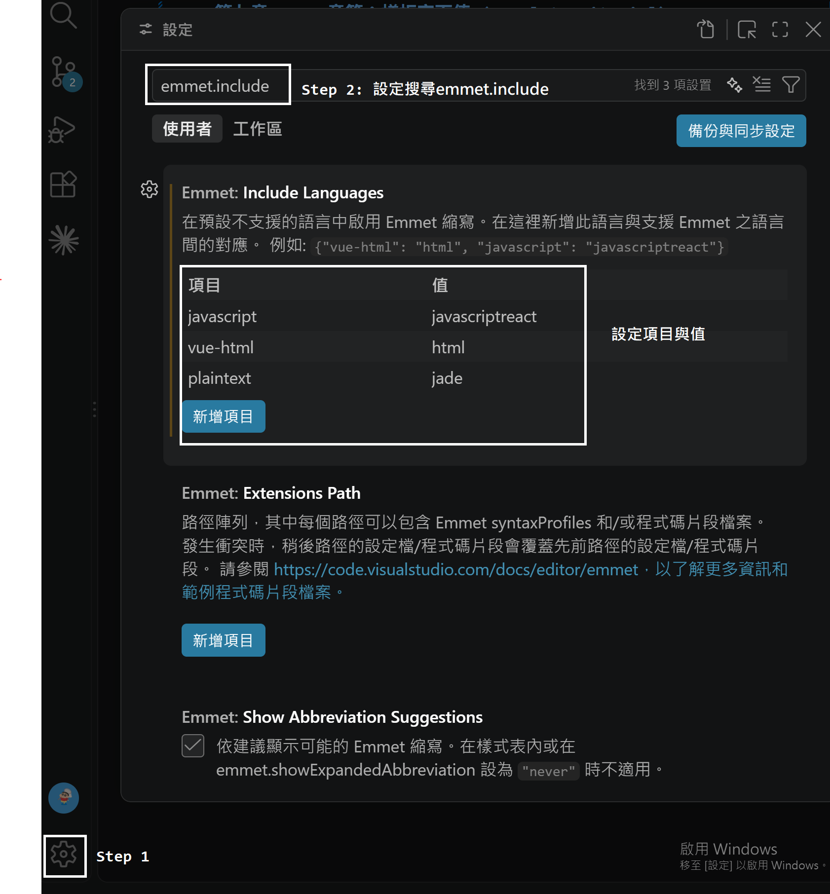

## 第九章  ES6 章節：樣板字面值 (Template Literal)
### 9-1 基本介紹
樣板字面值（Template Literal）是 ES6 新增的字串寫法，使用**反引號（`` ` ``，鍵盤左上角 Esc 下方）**包住字串，主要有三個特色：

| 特色 | 說明 |
| --- | --- |
| 嵌入表達式 | `${...}` 裡面可放任何**表達式**（變數、運算、函式呼叫、三元運算子…），結果會自動轉成字串 |
| 多行字串 | 直接換行即可，不用再寫 `\n` 或用 `+` 連接 |
| 標籤樣板 | 在反引號前加上函式名稱，可自訂字串處理方式（見 9-4） |

```
const age = 18;
// 過去連接字串的方式：let b = '我今年 ' + age + ' 歲'
// 樣板字面值寫法：    let b = `我今年 ${ age } 歲`

// ${} 內是「表達式」，所以可以做運算、呼叫函式、使用三元運算子
console.log(`明年 ${age + 1} 歲`);                    // 明年 19 歲
console.log(`${age >= 18 ? "成年" : "未成年"}`);        // 成年
console.log(`大寫：${"abc".toUpperCase()}`);           // 大寫：ABC

// 多行字串：過去需要 \n 或 + 連接，現在直接換行
const old = "第一行\n" + "第二行";
const text = `第一行
第二行`;                                                // 換行、縮排都會被保留
```

**注意事項**
* `${}` 裡面只能放**表達式**（有回傳值的），不能放 `if`、`for` 這類敘述。
* 一般字串內若要使用反引號本身，需跳脫：`` `\`` ``；要輸出 `${` 字面文字，寫成 `\${`。
* `${}` 內的值會呼叫 `toString()` 轉字串：`undefined` 會變成 `"undefined"`、物件會變成 `[object Object]`、陣列會用逗號連接。
* 多行字串時，**行首縮排的空白也會成為字串內容**，輸出到畫面或比對字串時要留意。

**實際範例：將陣列資料渲染成 HTML 清單**
```
const obj = [{ name: "Kent", age: 18 }, { name: "Leo", age: 81 }];

document.querySelector("ul").innerHTML = "";
obj.forEach(item => {
  document.querySelector("ul").innerHTML += `我是 ${item.name}，今年 ${item.age}`;
});
```
* 原寫法每跑一次迴圈就修改一次 DOM，效能較差；而且沒有 `<li>` 標籤，畫面上會連在一起。建議改成「先組好字串、最後一次寫入」：
```
const ul = document.querySelector("ul");
ul.innerHTML = obj
  .map(item => `<li>我是 ${item.name}，今年 ${item.age}</li>`)
  .join("");
```
* `map` 回傳的是陣列，直接放進 `innerHTML` 會以逗號連接，所以要加上 `.join("")` 把陣列合併成一個字串。

---

### 9-2 樣板字面值技巧：VSCode 搭配 Emmet 撰寫 HTML 結構
在樣板字面值內撰寫 HTML 字串時，沒有語法提示很容易出錯。VSCode 內建 Emmet，只要設定讓 JavaScript 檔也能使用 Emmet 縮寫，就可以快速產生 HTML 結構。

**設定步驟**（對照下圖）



1. Step 1：點選 VSCode 左下角的齒輪 → 設定。
2. Step 2：在搜尋欄輸入 `emmet.include`，找到「Emmet: Include Languages」，按「新增項目」，項目填 `javascript`、值填 `javascriptreact`（可再新增 `vue-html → html`、`plaintext → jade`）。
3. 或是直接在 `settings.json`（專案 `.vscode/settings.json` 或使用者設定）新增以下內容：
```
"emmet.triggerExpansionOnTab": true,
"emmet.includeLanguages": {
    "javascript": "javascriptreact",
    "vue-html": "html",
    "plaintext": "jade"
},
```

| 設定 | 說明 |
| --- | --- |
| `emmet.triggerExpansionOnTab` | 按 `Tab` 就展開 Emmet 縮寫（預設只會出現建議清單） |
| `emmet.includeLanguages` | 把某個語言「對應」到另一個支援 Emmet 的語言。`"javascript": "javascriptreact"` 表示 `.js` 檔也套用 JSX 的 Emmet 規則 |

**測試**：在 JS 檔中輸入 `` const x = `p*5` ``，游標停在 `5` 後面按下 `Tab`，若成功會展開成 5 個 `<p></p>`：
```
const x = `<p></p>
<p></p>
<p></p>
<p></p>
<p></p>`
```

**常用 Emmet 縮寫範例**
| 縮寫 | 展開結果 |
| --- | --- |
| `ul>li*3` | `<ul><li></li><li></li><li></li></ul>`（會自動換行縮排） |
| `div.card>h5.title+p` | `<div class="card"><h5 class="title"></h5><p></p></div>` |
| `a#link[href="#"]` | `<a href="#" id="link"></a>` |
| `li.item$*3` | `<li class="item1"></li>` … `item3`（`$` 為流水號） |
| `p{Hello}` | `<p>Hello</p>`（`{}` 為文字內容） |

* 若按 `Tab` 沒反應：確認設定已儲存、檔案語言模式為 JavaScript、且游標位置在反引號字串**內**。
* 展開後再把內容換成 `${...}` 即可，這樣比手打整段 HTML 快又不易漏掉結尾標籤。

---

### 9-3 巢狀結構
`${}` 裡面是表達式，所以可以再放入函式、另一個樣板字面值、陣列方法等，形成巢狀結構。

```
const person = { name: "Ming" };

// 1. 變數 / 屬性
const sentense1 = `我是 ${person.name}`;              // 我是 Ming

// 2. 賦值運算式：整個運算式的值就是被賦予的值，同時也會改變 person.name
const sentense2 = `我是 ${person.name = "Kent"}`;      // 我是 Kent，此時 person.name 也變成 "Kent"

// 3. 樣板字面值插入立即函式（IIFE）：可在 ${} 內寫多行邏輯
const sentense3 = `我是 ${(() => {
  const first = person.name.toUpperCase();
  return first + "（IIFE 回傳）";
})()}`;                                                // 我是 KENT（IIFE 回傳）

// 4. 樣板字面值插入樣板字面值：常搭配三元運算子做條件顯示
const isVip = true;
const sentense4 = `我是 ${person.name}，${isVip ? `等級 <b>${"VIP"}</b>` : "一般會員"}`;
// 我是 Kent，等級 <b>VIP</b>

// 5. 樣板字面值插入 map 函數：陣列轉成多筆 HTML，記得 join("")
const hobbies = ["閱讀", "游泳", "寫程式"];
const sentense5 = `我是 ${person.name}，我的興趣：
<ul>
  ${hobbies.map(h => `<li>${h}</li>`).join("")}
</ul>`;
```

**說明與重點**
1. **IIFE（立即函式）**：`(() => {...})()` 要用 `( )` 包起來再呼叫；適合需要「先宣告變數、再多行處理」的情況。簡單邏輯用三元運算子即可，不必刻意用 IIFE。
2. **條件顯示**：樣板字面值內不能寫 `if`，要用三元運算子 `條件 ? 真 : 假`，不顯示時回傳空字串 `""`（不要回傳 `undefined`、`null`，否則畫面會出現字樣 `undefined`）。
3. **map + join("")**：`map` 回傳陣列，陣列轉字串時預設以 `,` 連接，因此一定要 `.join("")`。
```
console.log(`${[1, 2, 3]}`);            // "1,2,3"
console.log(`${[1, 2, 3].join("")}`);   // "123"
```
4. **巢狀的樣板字面值可無限疊加**，但層數太多可讀性會變差，建議拆成多個小函式（見 9-5 的 `cardTemplate`）。
5. 巢狀時**反引號不需要跳脫**，因為 `${}` 內已經回到「程式碼」模式。

---

### 9-4 標籤樣板字面值 (Tagged Template)
在樣板字面值前面加上函式名稱，該函式就會被呼叫，稱為「標籤樣板」。

```
function x(strings, ...arg){
  console.log(strings, arg);
}
x`${1}+${2}+${3}`
```
**執行結果**
```
["", "+", "+", ""]   [1, 2, 3]
```
**函式參數說明**
| 參數 | 內容 |
| --- | --- |
| 第 1 個參數 `strings` | 被 `${}` 切開的**字串片段陣列**，並有 `strings.raw` 屬性（未跳脫的原始字串） |
| 其餘參數 `...arg` | 依序為每個 `${}` 的**運算結果** |
| 回傳值 | 函式回傳什麼，整個標籤樣板的結果就是什麼（**不一定是字串**） |

* 規則：`strings.length` 永遠等於 `arg.length + 1`。`${}` 在最前或最後時，對應位置會是空字串 `""`。
* 標籤樣板的呼叫**不用括號**，等同 `x(["", "+", "+", ""], 1, 2, 3)`。

#### 範例一：把字串與值交錯組回來（還原預設行為）
```
function plain(strings, ...values) {
  return strings.reduce((result, str, i) => result + str + (values[i] ?? ""), "");
}
const name = "Kent", age = 18;
console.log(plain`我是 ${name}，今年 ${age} 歲`);  // 我是 Kent，今年 18 歲
```
* `reduce` 逐一把「字串片段 + 值」接起來。最後一個片段後面沒有值，所以用 `values[i] ?? ""` 補空字串。

#### 範例二：highlight 高亮顯示變數
```
function highlight(strings, ...values) {
  return strings.reduce(
    (result, str, i) =>
      result + str + (i < values.length ? `<mark>${values[i]}</mark>` : ""),
    ""
  );
}
const user = "Ming", score = 95;
document.body.innerHTML = highlight`${user} 的分數是 ${score} 分`;
// <mark>Ming</mark> 的分數是 <mark>95</mark> 分
```

#### 範例三：數字格式化（貨幣）
```
const money = (strings, ...values) =>
  strings.reduce((result, str, i) => {
    const v = values[i];
    return result + str + (typeof v === "number" ? `NT$ ${v.toLocaleString()}` : v ?? "");
  }, "");

console.log(money`總共 ${1234567} 元，運費 ${60} 元`);
// 總共 NT$ 1,234,567 元，運費 NT$ 60 元
```

#### 範例四：防止 XSS（跳脫 HTML 特殊字元）
使用者輸入的內容若直接放進 `innerHTML`，可能被植入惡意 `<script>`、`onerror`；用標籤樣板可統一跳脫，**只跳脫 `${}` 的值，不影響自己寫的 HTML**。
```
function safeHTML(strings, ...values) {
  const escape = s => String(s)
    .replace(/&/g, "&amp;")
    .replace(/</g, "&lt;")
    .replace(/>/g, "&gt;")
    .replace(/"/g, "&quot;")
    .replace(/'/g, "&#39;");
  return strings.reduce((result, str, i) => result + str + (i < values.length ? escape(values[i]) : ""), "");
}
const input = ``;
console.log(safeHTML`<p>留言：${input}</p>`);
// <p>留言：&lt;img src=x onerror=&quot;alert(1)&quot;&gt;</p>
```
* 這是標籤樣板最實用的場景之一（`lit-html`、`styled-components` 等函式庫也是用這個原理）。

#### 範例五：strings.raw 取得原始字串
```
function showRaw(strings) {
  console.log(strings[0]);       // 換行會真的換行
  console.log(strings.raw[0]);   // 保留 \n 這兩個字元
}
showRaw`第一行\n第二行`;
// 第一行
// 第二行
// 第一行\n第二行
```
* 內建的 `String.raw` 就是這個用途，常用於 Windows 路徑、正規表示式：
```
console.log(String.raw`C:\Users\kent\new`);  // C:\Users\kent\new（不會被當成 \n 換行）
```

#### 範例六：回傳「非字串」的結果
標籤函式可以回傳任何型別，例如物件，做為簡易的查詢語法：
```
function sql(strings, ...values) {
  return {
    text: strings.reduce((r, s, i) => r + s + (i < values.length ? `$${i + 1}` : ""), ""),
    values,
  };
}
const id = 5, status = "open";
console.log(sql`SELECT * FROM todo WHERE id = ${id} AND status = ${status}`);
// { text: "SELECT * FROM todo WHERE id = $1 AND status = $2", values: [5, "open"] }
```
* 值被分開存放，不直接拼進 SQL 字串，可避免 SQL Injection（資料庫套件常用此設計）。

#### 範例七：觀察 strings 與 values 的對應
```
function debug(strings, ...values) {
  console.log("strings:", strings);
  console.log("values :", values);
}
debug`Hello ${"A"} and ${"B"}!`;
// strings: ["Hello ", " and ", "!"]
// values : ["A", "B"]
debug`${1}${2}`;
// strings: ["", "", ""]    values: [1, 2]   ← 連續 ${} 之間是空字串
debug`沒有變數`;
// strings: ["沒有變數"]     values: []
```

**重點整理**
1. 標籤樣板 = 「用函式處理樣板字面值」，傳入 `(字串陣列, ...值)`。
2. 常見用途：HTML 跳脫、格式化、多國語系、CSS-in-JS、SQL 參數化。
3. 與一般函式呼叫 `fn(\`...\`)` 不同：後者只會收到「已組好的完整字串」，無法區分哪些是變數。

---

### 9-5 課後習題
請串接[API](https://raw.githubusercontent.com/hexschool/js-training/main/travelApi.json)，套用Bootstrap卡片樣式將資料呈現出來，卡片樣式的HTML需套用到樣板字面值中，且程式碼需排列清楚。

**完整範例檔**：[Examples/ch09-05.html](../Examples/ch09-05.html)

#### 一、先觀察 API 資料結構
API 回傳的 JSON 格式如下，實際資料在 `data` 陣列中：
```
{
  "data": [
    {
      "id": 0,
      "name": "肥宅心碎賞櫻3日",
      "imgUrl": "https://images.unsplash.com/...",
      "area": "高雄",
      "description": "賞櫻花最佳去處。肥宅不得不去的超讚景點！",
      "group": 87,
      "price": 1400,
      "rate": 10
    },
    ...
  ]
}
```
| 欄位 | 說明 | 用在卡片的哪裡 |
| --- | --- | --- |
| `name` | 行程名稱 | 卡片標題 |
| `imgUrl` | 圖片網址 | 卡片圖片 |
| `area` | 地區 | 左上角標籤 |
| `description` | 描述 | 卡片內文 |
| `group` | 組數 | 底部「剩下最後 N 組」 |
| `price` | 價錢 | 底部價錢 |
| `rate` | 評分 | 右上角標籤 |

#### 二、完整程式碼
```
<!DOCTYPE html>
<html lang="zh-Hant">
  <head>
    <meta charset="UTF-8" />
    <meta name="viewport" content="width=device-width, initial-scale=1.0" />
    <title>Ch09 課後習題：旅遊卡片</title>
    <!-- 引入 Bootstrap 5 CSS -->
    <link
      href="https://cdn.jsdelivr.net/npm/bootstrap@5.3.3/dist/css/bootstrap.min.css"
      rel="stylesheet"
    />
  </head>
  <body class="bg-light">
    <div class="container py-4">
      <h1 class="h3 mb-4">熱門旅遊行程</h1>
      <!-- 卡片會被渲染到這裡 -->
      <div class="row g-4" id="cardList">
        <p class="text-muted">資料載入中...</p>
      </div>
    </div>

    <script>
      const API_URL =
        "https://raw.githubusercontent.com/hexschool/js-training/main/travelApi.json";
      const cardList = document.querySelector("#cardList");

      // 單張卡片的樣板：傳入一筆行程資料，回傳 HTML 字串
      // 參數使用「解構」，直接取出需要的欄位
      const cardTemplate = ({
        name,
        imgUrl,
        area,
        description,
        group,
        price,
        rate,
      }) => `
        <div class="col-12 col-md-6 col-lg-4">
          <div class="card h-100 shadow-sm">
            <div class="position-relative">
              
              <span class="badge bg-info position-absolute top-0 start-0 m-2">
                ${area}
              </span>
              <span class="badge bg-danger position-absolute top-0 end-0 m-2">
                ${rate} 分
              </span>
            </div>
            <div class="card-body">
              <h5 class="card-title">${name}</h5>
              <p class="card-text text-muted">${description}</p>
            </div>
            <div class="card-footer d-flex justify-content-between align-items-center">
              <small class="text-muted">剩下最後 ${group} 組</small>
              <span class="fs-5 fw-bold text-primary">
                TWD ${price.toLocaleString()}
              </span>
            </div>
          </div>
        </div>
      `;

      // 取得資料 → 每筆轉成卡片字串 → join("") 合併 → 一次寫入 DOM
      fetch(API_URL)
        .then((res) => {
          if (!res.ok) throw new Error(`HTTP ${res.status}`);
          return res.json();
        })
        .then(({ data }) => {
          cardList.innerHTML = data.map((item) => cardTemplate(item)).join("");
        })
        .catch((err) => {
          cardList.innerHTML = `<p class="text-danger">資料載入失敗：${err.message}</p>`;
        });
    </script>
  </body>
</html>
```

#### 三、程式碼解說
1. **引入 Bootstrap**：用 CDN 載入 CSS 即可使用卡片（`card`）、網格（`row` / `col-*`）、標籤（`badge`）等樣式，不需自己寫 CSS。
2. **`cardTemplate` 函式**：把卡片的 HTML 放進樣板字面值，資料用 `${}` 嵌入。
   * 參數寫成 `({ name, imgUrl, ... })`（物件解構），在樣板中可直接寫 `${name}`，不必每次寫 `item.name`。
   * 把樣板拆成獨立函式，主流程就能保持簡短、易讀，也方便日後替換卡片樣式。
   * `price.toLocaleString()` 會加上千分位（`1400` → `1,400`）。
3. **`fetch(API_URL)`**：回傳 Promise。
   * 第一個 `.then`：先檢查 `res.ok`（HTTP 狀態 200–299）；失敗就丟出錯誤，成功則 `res.json()` 把回應轉為物件（這也是 Promise，所以可以接著 `.then`）。
   * 第二個 `.then`：參數 `({ data })` 直接解構出 `data` 陣列。
   * `.catch`：網路錯誤或上面丟出的錯誤都會到這裡，在畫面顯示失敗訊息。
4. **`data.map(...).join("")`**：每筆資料轉成一段 HTML 字串，`join("")` 合併為單一字串（否則陣列轉字串會出現逗號），再**一次**賦值給 `innerHTML`，效能比在迴圈內重複 `+=` 好。
5. **RWD 排版**：`col-12 col-md-6 col-lg-4` 表示手機一排 1 張、平板一排 2 張、電腦一排 3 張；`h-100` 讓同一列的卡片高度一致；`g-4` 為卡片間距。
6. **圖片處理**：`object-fit: cover` 搭配固定高度，讓不同比例的圖片都能填滿而不變形。

#### 四、替代寫法（async / await）
```
async function init() {
  try {
    const res = await fetch(API_URL);
    if (!res.ok) throw new Error(`HTTP ${res.status}`);
    const { data } = await res.json();
    cardList.innerHTML = data.map(cardTemplate).join("");
  } catch (err) {
    cardList.innerHTML = `<p class="text-danger">資料載入失敗：${err.message}</p>`;
  }
}
init();
```
* `data.map(cardTemplate)` 可行，因為 `map` 會傳入 `(item, index, array)`，而 `cardTemplate` 只用第一個參數，多的會被忽略。若函式有第二個參數，則要用 `item => cardTemplate(item)` 以免被誤用。

#### 五、常見問題
| 問題 | 原因與解法 |
| --- | --- |
| 畫面出現 `,`（逗號） | 忘記 `.join("")` |
| 畫面出現 `undefined` | 欄位名稱打錯（區分大小寫，如 `imgUrl`），或資料沒有該欄位 |
| 畫面空白、Console 顯示 `Cannot read properties of undefined (reading 'map')` | 忘記取 `data`：回傳是 `{ data: [...] }`，要用 `res.data` 或解構 |
| 圖片沒有顯示 | 圖片網址錯誤或網路問題；檢查 `src="${imgUrl}"` 的引號是否有加 |
| `fetch` 失敗（CORS） | 此 API 允許跨來源請求，可直接用 `file://` 開啟或搭配 Live Server |

#### 六、安全提醒
* 本題資料來源是固定的練習用 API，可直接 `innerHTML`。實務上若資料來自使用者輸入或不可信來源，應使用 9-4 範例四的跳脫函式，或改用 `textContent` / `createElement`，避免 XSS。
